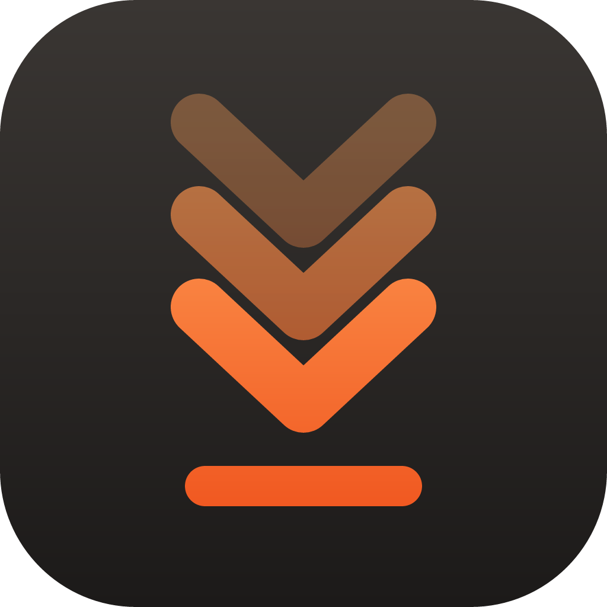
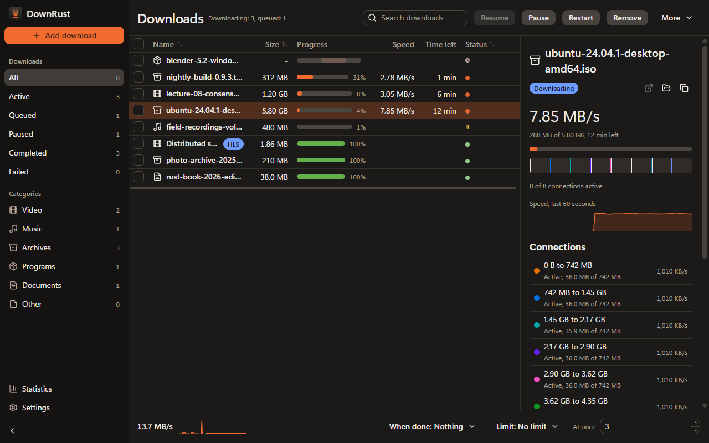
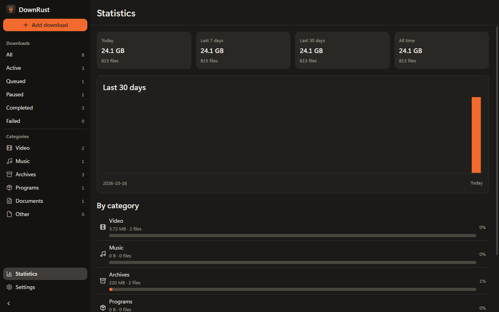
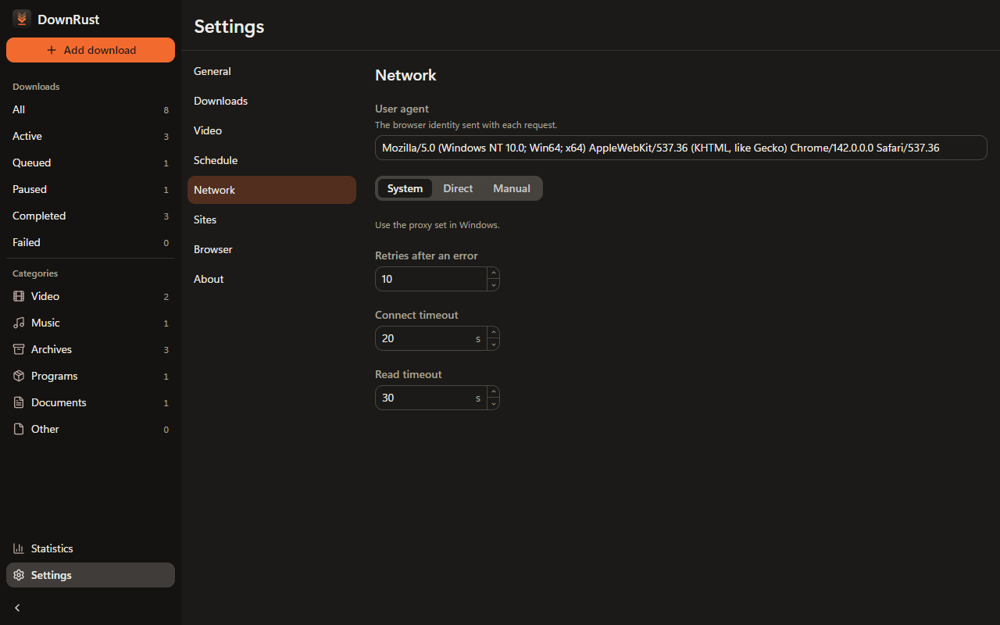
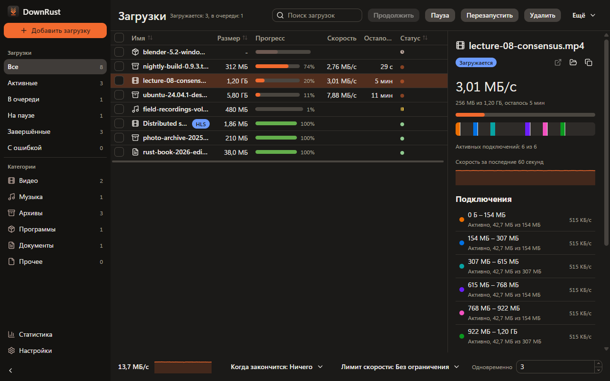
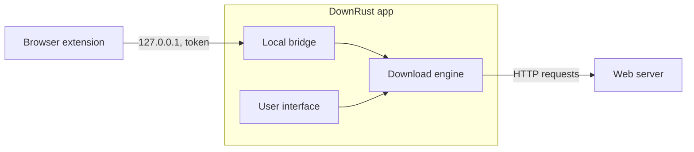

<p align="center">
  
</p>

<h1 align="center">DownRust</h1>

<p align="center">
  A fast segmented download manager for Windows, written in Rust.
</p>

<p align="center">
  <a href="README.ru.md">Русский</a> · <b>English</b>
</p>

<p align="center">
  <a href="https://github.com/useruserdev/DownRust/actions/workflows/ci.yml"></a>
  <a href="LICENSE"></a>
  <a href="https://github.com/useruserdev/DownRust/releases/latest"></a>
  
  
</p>

<p align="center">
  <picture>
    <source media="(prefers-color-scheme: light)" srcset="docs/screenshots/downloads-light.png">
    
  </picture>
</p>

---

## Features

**Downloads engine**

- Segmented downloads over several connections, IDM-style: when a connection finishes its part, it takes over half of the largest part still left.
- Resume after pause, restart or crash.
- Automatic retries after errors, with configurable timeouts.
- Speed limits for all downloads and for each download.
- Queue with a fixed order, a schedule for running hours and days, and an action when the queue is empty (sleep, hibernate, shut down or close).
- Categories with automatic sorting into `Downloads\DownRust`.
- SHA-256 verification of finished files.
- Refresh of an expired link without losing the download.
- Sparse files and optional disk space reservation before the download starts.
- Mirrors: one file from several servers at the same time.
- Speed schedule with different limits for hours and days.
- Automatic SHA-256 check against a published `.sha256` file or `SHA256SUMS` list.
- Torrents (magnet links and `.torrent` files), FTP, FTPS and SFTP.

**Video**

- Videos from YouTube, VK, Rutube, Twitch, TikTok, Vimeo and many other sites, with a choice of quality, through yt-dlp. DownRust downloads yt-dlp when needed and keeps it up to date.
- HLS streams, including AES-128 encrypted streams, with a choice of quality.
- DASH streams and separate audio tracks, merged with ffmpeg.

**Browser**

- Browser extension for Chrome, Edge, Firefox and Zen.
- Capture of browser downloads and a "Download with DownRust" context menu.
- Detection of HLS and DASH streams on the page, and a button for video pages.
- "Download all links with DownRust" with filters by file type.
- Automatic connection to the app, without copying the port and the token.

**Network**

- Proxy from Windows, a direct connection, or a manual proxy, including SOCKS5.
- Proxy rules for each site.
- HTTP Basic logins for each site, stored in Windows Credential Manager.

**Desktop**

- Tray icon, floating drop zone and clipboard monitor for links.
- Drag and drop, and batch add with number patterns such as `[001-120]`.
- Warnings about duplicate downloads.
- Statistics for downloads.
- Optional scan of finished files with Windows Security.
- Start with Windows, single instance and portable mode.
- Updates inside the app with release notes (Settings → About).
- Progress on the taskbar button, jump list tasks, a command line and `downrust://` links.
- Import of a download list from IDM (`.ief`), a text file or a web page.
- English and Russian interface, with light and dark themes.

## Screenshots

| | |
|---|---|
|  <br> *Details panel with the segment map* |  <br> *Statistics* |
|  <br> *Settings* |  <br> *Russian interface* |

## Install

1. Open the [Releases](https://github.com/useruserdev/DownRust/releases) page.
2. Download the `.msi` or the `.exe` setup file of the latest version.
3. Run the file and follow the steps.

> **SmartScreen warning:** the installer is not code-signed yet. Windows may show a warning. Click **More info**, then **Run anyway**.

### Portable mode

To run DownRust from a folder, for example from a USB drive:

1. Copy the program files to a folder.
2. Create an empty file named `portable` next to `DownRust.exe`.
3. Start DownRust. Its data and logs are stored in the `data` folder next to the program.

## Browser extension

The extension sends downloads to DownRust. It works only while DownRust runs with the browser bridge enabled. If DownRust does not answer, the browser downloads the file as usual.

1. In DownRust, open **Settings**, then **Browser**, and turn on the bridge. The extension finds the port and the token by itself while DownRust is installed; you can also enter them by hand.
2. Install the extension:
   - **Chrome and Edge:** open `chrome://extensions` or `edge://extensions`, turn on **Developer mode**, choose **Load unpacked** and select the `extension` folder of this repository.
   - **Firefox:** open `about:debugging#/runtime/this-firefox` and choose **Load Temporary Add-on**. Select `manifest.json`. Firefox removes this add-on on restart.
   - **Zen and other Firefox-based browsers:** build the package with `npm run extension:build`. Set `xpinstall.signatures.required` to `false` in `about:config`. Then open `about:addons`, choose **Install Add-on From File** and select `dist-extension/downrust-<version>.xpi`.
3. Open the extension options. They show **Connected automatically** when the extension found DownRust. Otherwise turn on **Set port and token manually**, enter them, click **Save** and then **Test connection**.

## Video downloads

Paste the address of a video page (for example a YouTube video) in the Add dialog, choose the quality and start. DownRust uses [yt-dlp](https://github.com/yt-dlp/yt-dlp) for video sites and downloads it on first use.

HLS streams download without extra tools. ffmpeg is needed for MP4 conversion, for DASH streams and for HLS streams with a separate audio track.

Install ffmpeg with winget:

```bash
winget install Gyan.FFmpeg
```

Then set the path to ffmpeg under **Settings**, then **Video**. You can also place `ffmpeg` next to `DownRust.exe`.

## Build from source

You need:

- Rust (stable), with the MSVC toolchain from Visual Studio Build Tools
- Node.js 22 or newer

Install the dependencies and start the app in development mode:

```bash
npm install
npm run tauri dev
```

Build the installers:

```bash
npm run tauri build
```

Run the checks:

```bash
cargo test --workspace
npm test
```

Build the browser extension package:

```bash
npm run extension:build
```

## Architecture

DownRust is a Cargo workspace with a Node.js frontend:

- `crates/downrust-core` is the download engine. It handles HTTP, segments, the queue, the scheduler, media streams and the SQLite store.
- `crates/downrust-testserver` is a local test server used by the engine tests.
- `src-tauri` is the desktop shell. It holds the tray, settings, the local browser bridge and the commands for the user interface.
- `src` is the user interface, built with React 19 and Astryx, a design system by Meta.
- `extension` is the browser extension for Chrome, Edge, Firefox and Zen.



## Privacy

- DownRust has no telemetry and sends no usage data.
- The browser bridge listens on `127.0.0.1` only. Requests need the token from the settings.
- Site logins are stored in Windows Credential Manager.

## Contributing

See [CONTRIBUTING.md](CONTRIBUTING.md). Release notes are in [CHANGELOG.md](CHANGELOG.md).

## License

DownRust is free software under the GNU General Public License, version 3 or later. See [LICENSE](LICENSE).

The user interface uses the Astryx design system, which is distributed under the MIT License. See [THIRD_PARTY_NOTICES.md](THIRD_PARTY_NOTICES.md).
