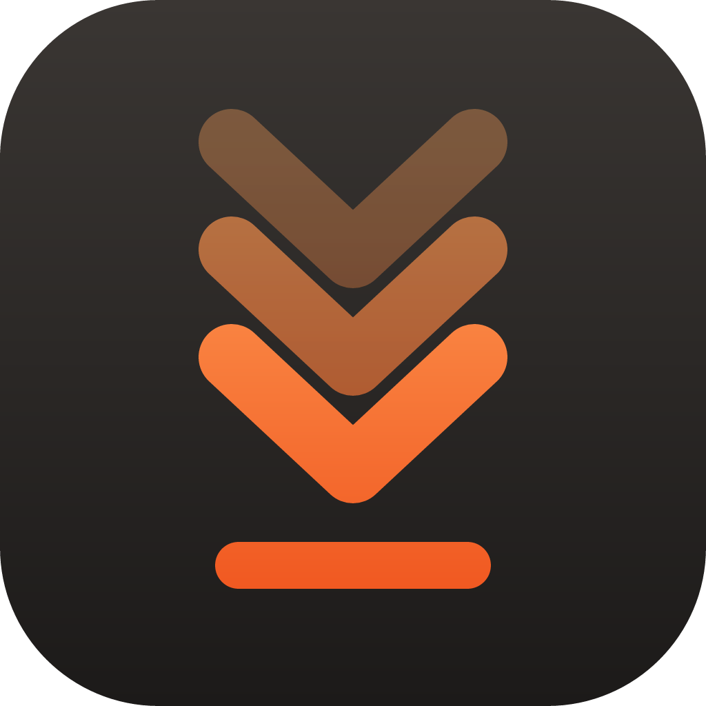
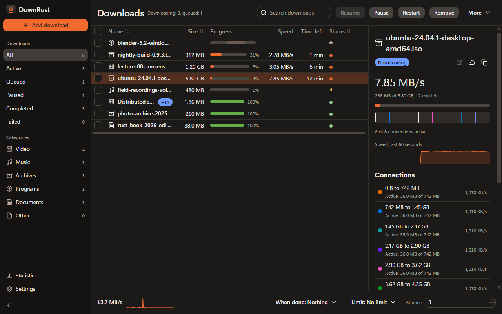
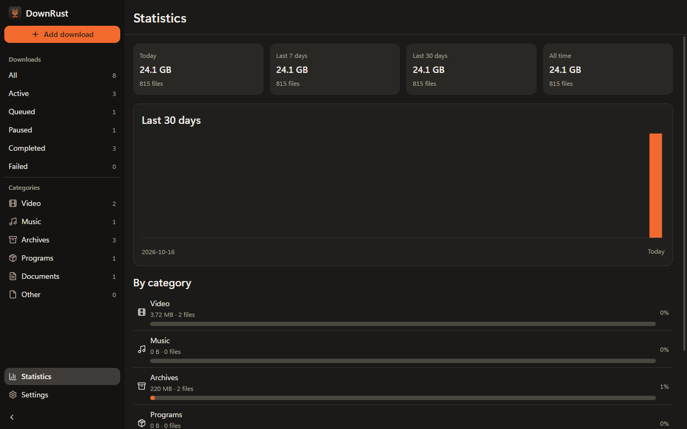
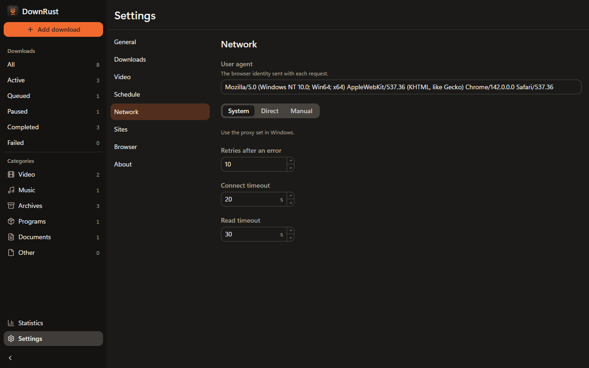
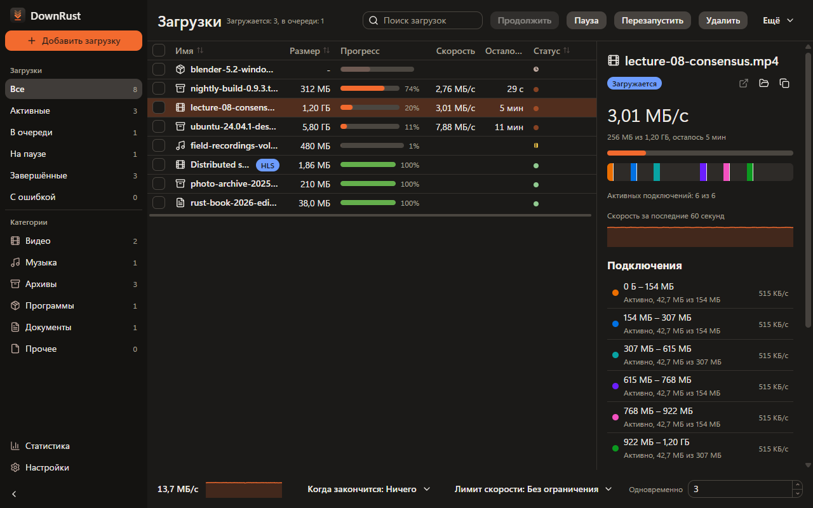
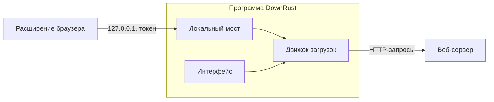

<p align="center">
  
</p>

<h1 align="center">DownRust</h1>

<p align="center">
  Быстрый менеджер загрузок с сегментированием для Windows, написанный на Rust.
</p>

<p align="center">
  <b>Русский</b> · <a href="README.md">English</a>
</p>

<p align="center">
  <a href="https://github.com/useruserdev/DownRust/actions/workflows/ci.yml"></a>
  <a href="LICENSE"></a>
  <a href="https://github.com/useruserdev/DownRust/releases/latest"></a>
  
  
</p>

<p align="center">
  <picture>
    <source media="(prefers-color-scheme: light)" srcset="docs/screenshots/downloads-light.png">
    
  </picture>
</p>

---

## Возможности

**Движок загрузок**

- Сегментированная загрузка по нескольким соединениям как в IDM: освободившееся соединение забирает половину самой большой оставшейся части.
- Продолжение после паузы, перезапуска или сбоя.
- Автоматические повторы после ошибок, с настраиваемыми таймаутами.
- Ограничение скорости для всех загрузок и для каждой загрузки отдельно.
- Очередь с заданным порядком, расписание рабочих часов и дней и действие, когда очередь пуста (сон, гибернация, выключение или закрытие программы).
- Категории с автоматической сортировкой в папку `Downloads\DownRust`.
- Проверка готовых файлов по SHA-256.
- Обновление истёкшей ссылки без потери загрузки.
- Разреженные файлы и, при желании, резервирование места на диске до начала загрузки.
- Зеркала: один файл сразу с нескольких серверов.
- Расписание скорости с разными ограничениями по часам и дням.
- Автоматическая проверка по опубликованному файлу `.sha256` или списку `SHA256SUMS`.
- Торренты (magnet-ссылки и файлы `.torrent`), FTP, FTPS и SFTP.

**Видео**

- Видео с YouTube, VK, Rutube, Twitch, TikTok, Vimeo и многих других сайтов с выбором качества, через yt-dlp. DownRust сам скачивает yt-dlp и обновляет его.
- Потоки HLS, в том числе зашифрованные AES-128, с выбором качества.
- Потоки DASH и отдельные аудиодорожки, которые объединяются с помощью ffmpeg.

**Браузер**

- Расширение для Chrome, Edge, Firefox и Zen.
- Перехват загрузок браузера и пункт контекстного меню «Скачать через DownRust».
- Обнаружение потоков HLS и DASH на странице и кнопка для страниц с видео.
- «Скачать все ссылки через DownRust» с фильтрами по типу файлов.
- Автоматическое подключение к программе без копирования порта и токена.

**Сеть**

- Прокси из настроек Windows, прямое соединение или ручной прокси, в том числе SOCKS5.
- Правила прокси для каждого сайта.
- Логины HTTP Basic для каждого сайта, которые хранятся в Диспетчере учётных данных Windows.

**Рабочий стол**

- Значок в системном трее, плавающая зона для перетаскивания ссылок и отслеживание буфера обмена.
- Перетаскивание и пакетное добавление с шаблонами номеров, например `[001-120]`.
- Предупреждения о повторных загрузках.
- Статистика загрузок.
- Необязательная проверка готовых файлов средствами Безопасности Windows.
- Запуск вместе с Windows, одна копия программы и переносной режим.
- Обновления внутри программы со списком изменений (Настройки → О программе).
- Прогресс на кнопке панели задач, задачи в списке переходов, командная строка и ссылки `downrust://`.
- Импорт списка загрузок из IDM (`.ief`), текстового файла или веб-страницы.
- Интерфейс на английском и русском языках, светлая и тёмная темы.

## Скриншоты

| | |
|---|---|
|  <br> *Панель сведений с картой сегментов* |  <br> *Статистика* |
|  <br> *Настройки* |  <br> *Русский интерфейс* |

## Установка

1. Откройте страницу [Releases](https://github.com/useruserdev/DownRust/releases).
2. Скачайте файл установки `.msi` или `.exe` последней версии.
3. Запустите файл и следуйте шагам установщика.

> **Предупреждение SmartScreen:** установщик пока не подписан сертификатом кода. Windows может показать предупреждение. Нажмите **Подробнее**, затем **Всё равно выполнить**.

### Переносной режим

Чтобы запускать DownRust из папки, например с USB-накопителя:

1. Скопируйте файлы программы в папку.
2. Рядом с `DownRust.exe` создайте пустой файл с именем `portable`.
3. Запустите DownRust. Его данные и журналы хранятся в папке `data` рядом с программой.

## Расширение для браузера

Расширение отправляет загрузки в DownRust. Оно работает только тогда, когда DownRust запущен с включённым мостом для браузера. Если DownRust не отвечает, браузер скачивает файл обычным способом.

1. В DownRust откройте **Настройки**, затем раздел **Браузер**, и включите мост. Расширение само находит порт и токен, если DownRust установлен; их также можно ввести вручную.
2. Установите расширение:
   - **Chrome и Edge:** откройте `chrome://extensions` или `edge://extensions`, включите **Режим разработчика**, выберите **Загрузить распакованное** и укажите папку `extension` из этого репозитория.
   - **Firefox:** откройте `about:debugging#/runtime/this-firefox` и выберите **Загрузить временное дополнение**. Укажите файл `manifest.json`. Firefox удаляет такое дополнение при перезапуске.
   - **Zen и другие браузеры на движке Firefox:** соберите пакет командой `npm run extension:build`. В `about:config` задайте `xpinstall.signatures.required` равным `false`. Затем откройте `about:addons`, выберите **Установить дополнение из файла** и укажите `dist-extension/downrust-<версия>.xpi`.
3. Откройте настройки расширения. Если расширение нашло DownRust, там написано **Connected automatically**. Иначе включите **Set port and token manually**, введите их, нажмите **Save**, а затем **Test connection**.

## Загрузка видео

Вставьте в окно добавления адрес страницы с видео (например, ролика на YouTube), выберите качество и начните загрузку. Для сайтов с видео DownRust использует [yt-dlp](https://github.com/yt-dlp/yt-dlp) и скачивает его при первом использовании.

Потоки HLS загружаются без дополнительных программ. ffmpeg нужен для конвертации в MP4, для потоков DASH и для потоков HLS с отдельной аудиодорожкой.

Установить ffmpeg можно через winget:

```bash
winget install Gyan.FFmpeg
```

Затем укажите путь к ffmpeg в разделе **Настройки**, затем **Видео**. Также можно положить `ffmpeg` рядом с `DownRust.exe`.

## Сборка из исходного кода

Нужны:

- Rust (стабильная версия) с набором инструментов MSVC из Visual Studio Build Tools
- Node.js 22 или новее

Установите зависимости и запустите программу в режиме разработки:

```bash
npm install
npm run tauri dev
```

Соберите установщики:

```bash
npm run tauri build
```

Запустите проверки:

```bash
cargo test --workspace
npm test
```

Соберите пакет расширения для браузера:

```bash
npm run extension:build
```

## Архитектура

DownRust — это рабочее пространство Cargo с интерфейсом на Node.js:

- `crates/downrust-core` — движок загрузок. Он отвечает за HTTP, сегменты, очередь, планировщик, потоки видео и хранилище SQLite.
- `crates/downrust-testserver` — локальный тестовый сервер, который использует тесты движка.
- `src-tauri` — оболочка для рабочего стола. Она содержит трей, настройки, локальный мост для браузера и команды для интерфейса.
- `src` — интерфейс на React 19 и Astryx, дизайн-системе от Meta.
- `extension` — расширение для браузеров Chrome, Edge, Firefox и Zen.



## Приватность

- В DownRust нет телеметрии, и он не отправляет данные об использовании.
- Мост для браузера слушает только `127.0.0.1`. Запросы требуют токен из настроек.
- Логины сайтов хранятся в Диспетчере учётных данных Windows.

## Участие в разработке

См. [CONTRIBUTING.md](CONTRIBUTING.md). Список изменений находится в [CHANGELOG.md](CHANGELOG.md).

## Лицензия

DownRust — свободное программное обеспечение под лицензией GNU General Public License, версия 3 или новее. См. [LICENSE](LICENSE).

Интерфейс использует дизайн-систему Astryx, которая распространяется по лицензии MIT. См. [THIRD_PARTY_NOTICES.md](THIRD_PARTY_NOTICES.md).
